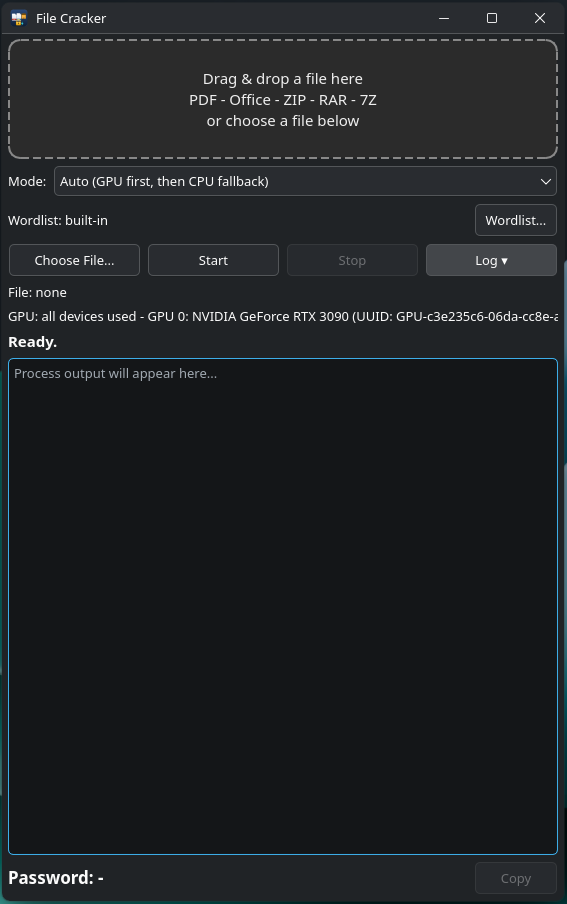
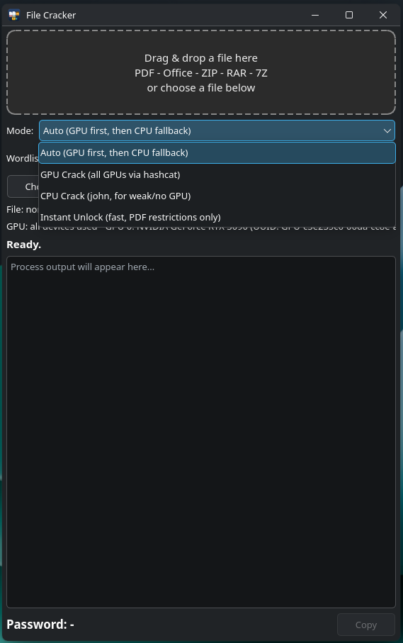

# File Cracker





One-click universal password recovery. Uses **ALL GPUs** (NVIDIA + AMD + Intel, no `-d` limit passed to hashcat).

## Supported files

| Type | Extensions | Hash extractor | hashcat modes |
|---|---|---|---|
| PDF | `.pdf` | `pdf2john` + instant unlock via `qpdf` + `pdfrip` CPU fallback | 10400, 10500, 10600, 10700 |
| Office (modern) | `.docx .xlsx .pptx .docm .xlsm .pptm` | `office2john` | 9400, 9500, 9600 |
| Office (legacy) | `.doc .xls .ppt` | `office2john` | 9700, 9800 family |
| LibreOffice | `.odt .ods .odp` | `libreoffice2john` | 18400, 18600 |
| ZIP | `.zip` | `zip2john` | 13600 (WinZip AES), 17200 family (PKZIP) |
| RAR | `.rar` | `rar2john` | 13000 (RAR5), 12500/23700/23800 (RAR3) |
| 7-Zip | `.7z` | `7z2john` | 11600 |
| KeePass | `.kdbx` | `keepass2john` | 13400, 34300 |
| iWork | `.pages .numbers .key` | `iwork2john` | 23300 |

## How it works

1. **Instant unlock (PDF only):** `qpdf --decrypt` removes print/restriction locks in ~0.01 s.
2. **GPU crack:** extract hash via `*2john`, then try with `hashcat` on **all cards**:
   common passwords → 4/6/8-digit numbers → short alphanumeric (1-4 chars).
3. **CPU fallback (PDF):** `pdfrip` empty password + date patterns.

Note: AES-256 (PDF 10700, 7z 11600, RAR5 13000, Office 2013+) is genuinely **slow**;
a strong unknown password can take hours/days. That is normal.

## Engine selection (in the window)

| Engine | What it does | For whom |
|---|---|---|
| Auto | GPU first, CPU fallback if not found | Recommended |
| GPU Crack | Only `hashcat` (all GPUs) | Strong graphics cards |
| CPU Crack | Only `john` (+ `pdfrip` for PDF) | Weak or no GPU |
| Instant Unlock | `qpdf --decrypt` (~0.01 s) | PDF restriction locks only |

## Install

### Single-file installer (all Linux)

`filecracker-kur.sh` auto-detects Arch/CachyOS, Debian/Ubuntu,
Fedora and openSUSE:

```bash
bash ~/Desktop/filecracker-kur.sh
```

### Debian / Ubuntu (.deb)

```bash
sudo apt install ./filecracker_2.0.0_all.deb
filecracker
```

### Fedora / openSUSE (.rpm)

```bash
sudo dnf install ./filecracker-2.0.0-1.noarch.rpm   # Fedora
sudo zypper install ./filecracker-2.0.0-1.noarch.rpm # openSUSE
filecracker
```

### Arch / CachyOS (AUR)

```bash
yay -S filecracker
filecracker
```

Conflicts with (replaces) the old `pdfcracker` package; the `pdfcracker` command stays as a symlink.

## Requirements

- `python-pyqt6`, `hashcat`, `john` (all `*2john` tools), `qpdf`
- Optional: `pdfrip` (PDF CPU fallback), `p7zip` + `unrar` (archive verify),
  `perl-compress-raw-lzma` (AUR, for `7z2john`), `rockyou` wordlist
- GPU: NVIDIA (CUDA) / AMD (ROCm/OpenCL) / Intel (OpenCL) — every device
  hashcat finds is used automatically, no setup needed.

## Files

- `filecracker.py` — the whole app (PyQt6)
- `filecracker.svg` — icon (PDF + DOC + ZIP + open lock + GPU spark)
- `filecracker.desktop` — menu/shortcut entry
- `common-passwords.txt` — built-in wordlist
- `screenshot.png`, `screenshot1.png` — app screenshots (this README)

## Test (2x RTX 3090, 5/5 in Auto and CPU modes)

| File | Auto | CPU |
|---|---|---|
| PDF (AES-256) | GPU 10700 | john PDF |
| DOCX (Office 2013) | GPU 9600 | john Office |
| ZIP (PKZIP) | john PKZIP (GPU misses, john instant) | john PKZIP |
| RAR5 | GPU 13000 | john RAR5 |
| 7Z | GPU 11600 | john 7z |

## VirusTotal

Scanned on [VirusTotal](https://www.virustotal.com):

| File | SHA256 | Report |
|---|---|---|
| `filecracker_2.0.0_debian-ubuntu-mint.deb` | `0e1824c6b0394bde2c668de7ff60c9eec6b888d13e52368b5dfeab49f5c88d44` | [virustotal.com/gui/file/0e1824c...](https://www.virustotal.com/gui/file/0e1824c6b0394bde2c668de7ff60c9eec6b888d13e52368b5dfeab49f5c88d44) |
| `filecracker_2.0.0_fedora-opensuse.rpm` | `688a2c30dbf911ad0cc95201e5c2b3cab2b1c2b693d6e3633863f11e818f377d` | [virustotal.com/gui/file/688a2c3...](https://www.virustotal.com/gui/file/688a2c30dbf911ad0cc95201e5c2b3cab2b1c2b693d6e3633863f11e818f377d) |
| `filecracker_2.0.0_all-linux.sh` | `37e3cec33e9b38f60f5e744b7ea53c5249e05238fe7a6f6698e8b73f7448dc95` | [virustotal.com/gui/file/37e3cec...](https://www.virustotal.com/gui/file/37e3cec33e9b38f60f5e744b7ea53c5249e05238fe7a6f6698e8b73f7448dc95) |

## License

MIT
